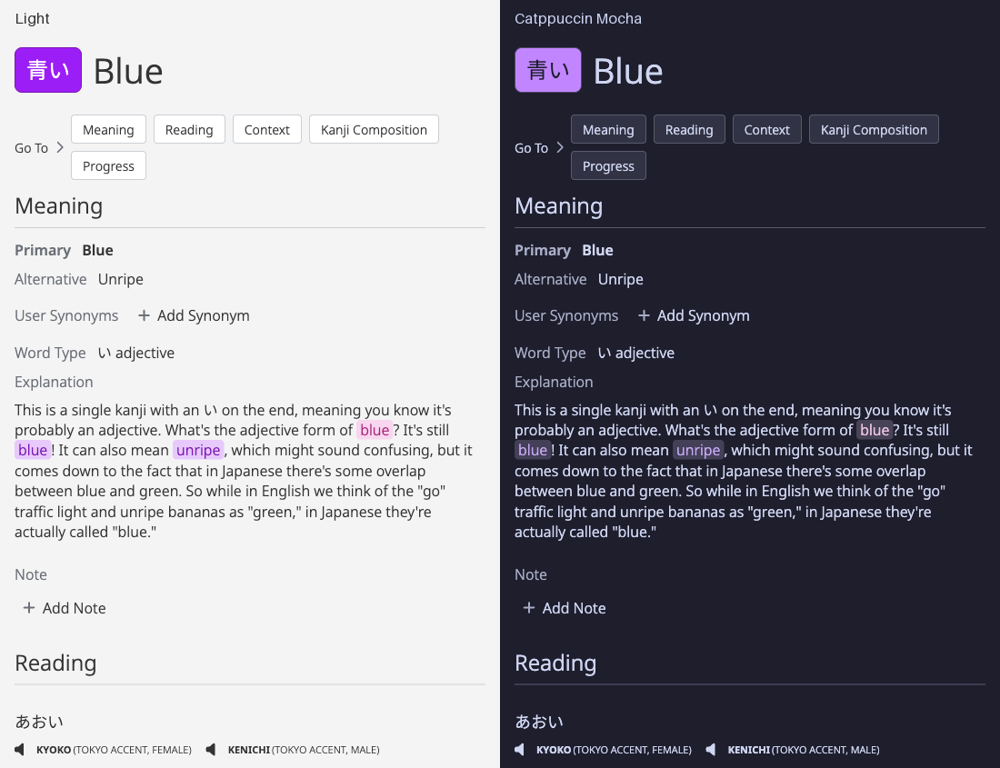
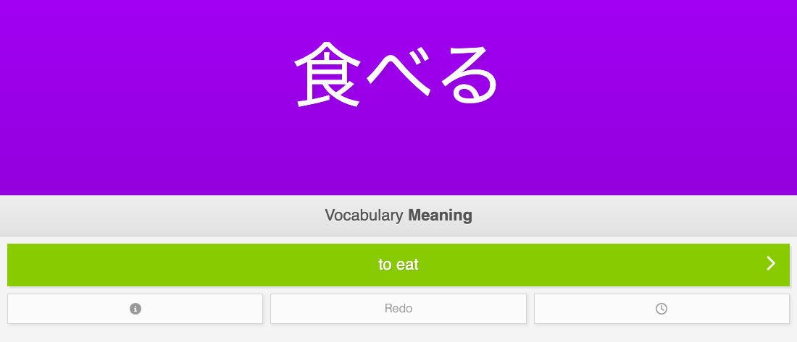
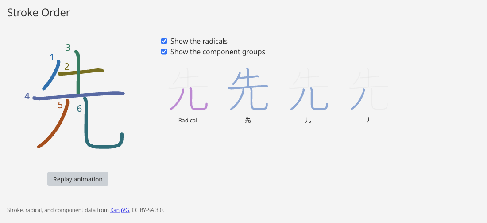
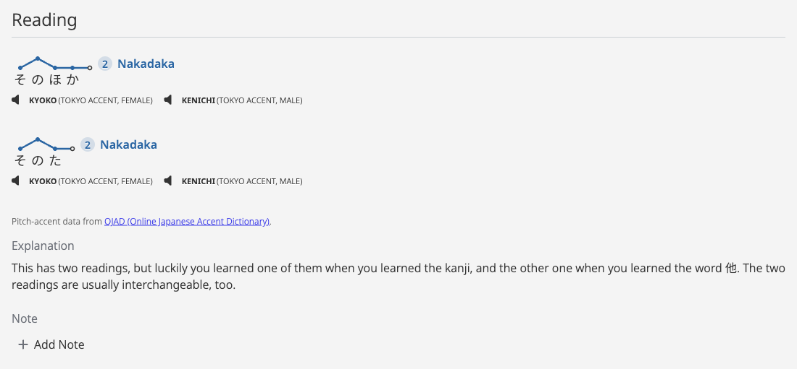

# WaniKani Userscripts

Small userscripts for improving WaniKani.

## Scripts

### WaniKani Catppuccin Mocha

Applies the [Catppuccin Mocha](https://github.com/catppuccin/catppuccin) palette across WaniKani, including coordinated colors for subject categories, quiz feedback, interface states, and diagrams added by WaniKani Pitch Accent. It follows the system color scheme by default; use the control in the lower-left corner to cycle through **System**, **Dark**, and **Light** modes.

Level-up banner titles follow the selected theme without recoloring the illustration. The script fetches the banner SVGs from WaniKani and adds a title-only dark-mode style, preserving responsive image selection and animations.



Install:
<https://raw.githubusercontent.com/fgsch/wanikani/main/wk-catppuccin-mocha.js>

### WaniKani Redo Answer

Adds a **Redo** control to WaniKani review and extra study quizzes so you can reopen a submitted answer and replace it before advancing.



Install:
<https://raw.githubusercontent.com/fgsch/wanikani/main/wk-redo-answer.js>

### WaniKani Stroke Order

Adds animated stroke-order diagrams to kanji subject pages, lessons, and review or extra study Item Info. Diagrams include optional radical and component group views and are retrieved from [KanjiVG](https://kanjivg.tagaini.net/) on GitHub.



Install:
<https://raw.githubusercontent.com/fgsch/wanikani/main/wk-stroke-order.js>

### WaniKani Pitch Accent

Adds compact pitch-pattern diagrams from [OJAD](https://www.gavo.t.u-tokyo.ac.jp/ojad/eng/pages/home) to Reading content on vocabulary subject pages, vocabulary and kanji lessons, and Item Info during reviews and extra study, including recent-mistakes quizzes. Japanese terms and readings are sent to this third-party service to retrieve pitch-accent data. Quiz diagrams remain hidden until the current answer has been submitted.

Review support includes both client-rendered Item Info and Turbo-frame layouts. After submitting an answer, open Item Info and expand Reading to see the diagrams.

Each distinct reading is looked up separately, with exact spelling and reading checks to exclude unrelated homophones. Vocabulary pages collect all readings from the Reading section, including alternatives not shown in the page header. Both current `data-name="reading"` sections and older class-based layouts are supported. When reading metadata is absent, the subject spelling is queried instead.



Install:
<https://raw.githubusercontent.com/fgsch/wanikani/main/wk-pitch-accent.js>

## Installation

Install a userscript manager such as Tampermonkey or Violentmonkey, then open one of the install links above and accept the script installation prompt.

## Development

Install dependencies and run the full check suite:

```sh
make check
```

Run only the tests:

```sh
make test
```

Run only lint checks:

```sh
make lint
```

## Credits

WaniKani Catppuccin Mocha uses the [Catppuccin](https://github.com/catppuccin/catppuccin) color palette, copyright (c) 2021 Catppuccin and licensed under the [MIT License](https://github.com/catppuccin/catppuccin/blob/main/LICENSE).

## License

MIT. See [LICENSE](LICENSE).
